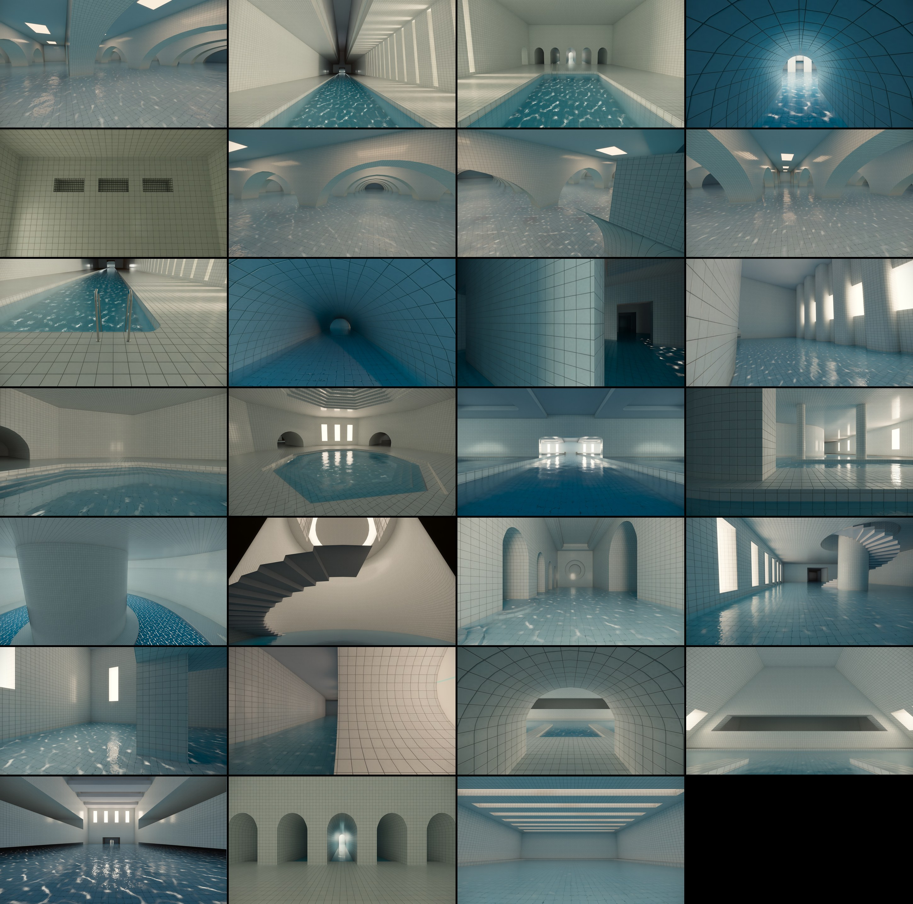
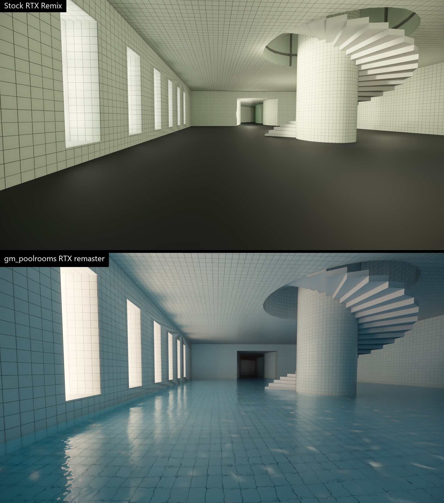
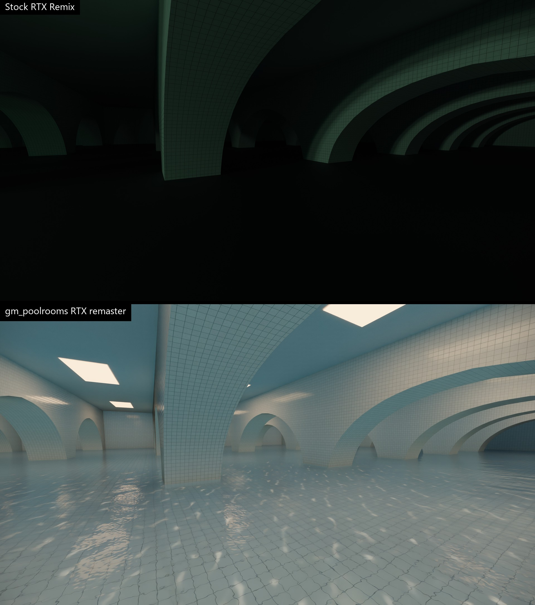
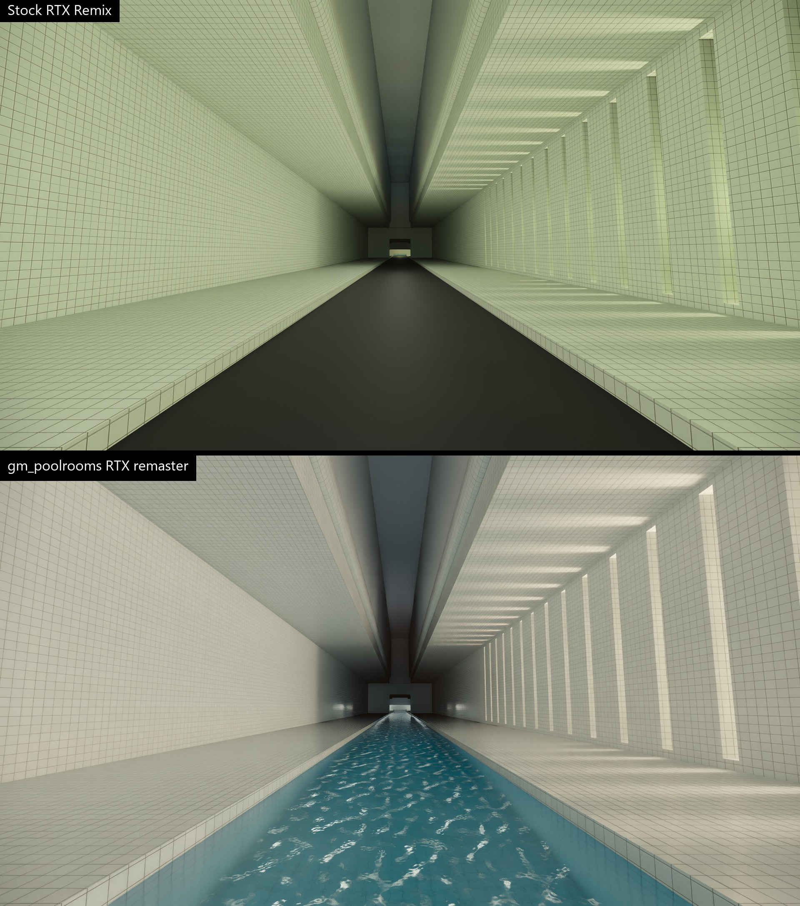
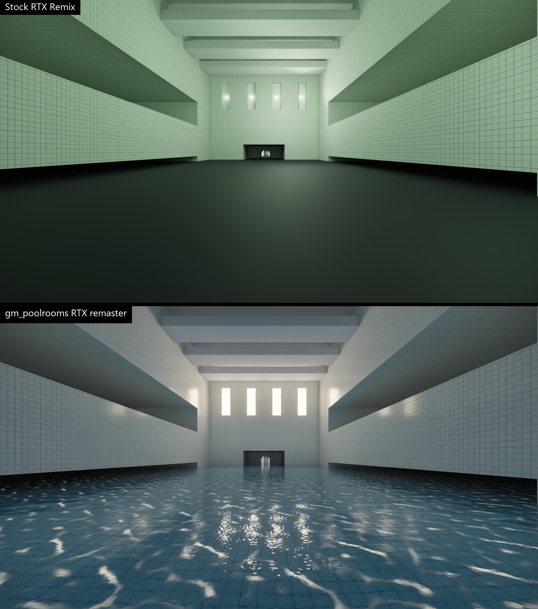

# gm_poolrooms — RTX Remix remaster

A path-traced remaster of the workshop map **gm_poolrooms** (workshop 2849511871) for
Garry's Mod RTX. The map file itself is untouched: everything is layered on top of it at
runtime, by a Remix mod (materials) and a small client Lua addon (lighting and map fixes).



## What it changes

**Materials** (Remix mod, `garrysmod/rtx-remix/mods/gm_poolrooms_rtx`)

| Surface | Replacement |
|---|---|
| Pool tile (all `pooltile*` variants share one texture) | 4K procedural PBR: glazed tiles with bevelled edges, lippage and slight tilt, recessed grout, wear and dirt in the joints; albedo, normal, roughness (glaze 0.075, grout 0.88), height for parallax |
| Plaster | 4K AI-upscaled albedo, original normal plus high-pass detail, matte roughness |
| Water | Drawn by the [RTX Water](RTX_WATER.md) addon when it is installed: pool water (translucent, IOR 1.333, clear turquoise absorption), calm and uniform, with simulated waves from players, objects and bullets (shaped by what moves through the water, with wakes and reflections off the pool walls). Without it, a flat translucent fallback of the same colour |
| Window and skylight openings (`NOTHINGNESS`) | White daylight emitters (5000 K) |
| Gate grilles | Round steel bars with alpha cutout, metallic |
| Pool ladders | Stainless steel, plastic and enamel parts, each with its own metal/roughness |
| Caustics | Animated, looping 8×8 sprite sheet computed by refracting light through a rippled surface; eight strength classes. Shown only while RTX Water has waves on: calm water casts none |

**Lighting and fixes** (Lua addon, `garrysmod/garrysmod/addons/gm_poolrooms_rtx`)

- 116 Remix API lights: 47 rect lights in the window and skylight openings, 19 spot and 22 point
  lights converted from the map's light entities, and 28 ceiling panels (with visible fixtures)
  for the vaulted north hall, which the original bake left unlit. The game's own lights are
  hidden from Remix while on this map.
- Water: with RTX Water installed, the addon answers its map profile hook with pool water and
  calm waves and leaves the water to it. Without it, the addon fixes the water itself: Source
  only draws what lies under opaque water into its refraction texture, so Remix saw no pool
  floor and the water turned black. The addon marks the water materials translucent so the
  floor is drawn, and binds a map-specific tag texture so the water replacement only applies
  here.
- Curved tile surfaces (arches, columns, round pools) used triplanar mapping, which Remix
  ignores, so they showed tiles 16× too large. They are unfolded offline into continuous UVs
  at the real tile size, redrawn with the tile material, and the originals are hidden.
- The map's fake light-shaft cone models are hidden (path-traced volumetrics replace them).
- Caustic overlay: underwater floors are cut into 64-unit cells, and each cell's strength comes
  from the direct light this remaster's own lights put on it through the water (Fresnel
  transmission, absorption, blur from the source size), with occlusion traced in game. Lit
  rooms also get a faint shimmer from bounced light; dark rooms stay dark. The overlay is
  built while RTX Water's waves are on and dropped when the water is calm.
- Scoped Remix settings (game lights off, volumetric haze tuned to the rooms) are applied on
  this map only and restored when you leave it.

## Install

It ships with this repository's builds (`garrysmod/addons/gm_poolrooms_rtx` and
`rtx-remix/mods/gm_poolrooms_rtx`); both parts must be present, and the map itself comes from
the workshop. To run it from a checkout instead, close the game first (a new Remix mod is only
discovered at startup) and link the two folders:

```bat
mklink /J "<GarrysMod_RTX>\rtx-remix\mods\gm_poolrooms_rtx" "<repository>\garrysmod\rtx-remix\mods\gm_poolrooms_rtx"
mklink /J "<GarrysMod_RTX>\garrysmod\addons\gm_poolrooms_rtx" "<repository>\garrysmod\garrysmod\addons\gm_poolrooms_rtx"
```

Copying the two folders instead of linking works too. The water comes from the
[RTX Water](RTX_WATER.md) addon, which ships alongside it and works on any map. Then start GMod RTX and load `gm_poolrooms`;
the console prints `[PoolRTX] ...` lines as the lights, water and overlays come up.
`poolrtx_reload` re-runs the addon. Without the Remix API (`RemixLight`) the addon does nothing.

Requirements: GMod RTX with gmRTX's Lua Remix API and a Remix runtime that loads colour inputs
(built and tested with dxvk-remix-gmod `remix-main+c6b48ed1`).

## Layout

Paths from the repository root; `garrysmod/` is what ships, laid out like the game folder.

```
garrysmod/rtx-remix/mods/gm_poolrooms_rtx/
                              mod.usda, materials.usda, textures/*.rtex.dds   (generated)
garrysmod/garrysmod/addons/gm_poolrooms_rtx/
                              lua/autorun/poolrooms_rtx.lua    boots on gm_poolrooms only
                              lua/poolrooms_rtx/sh_config.lua  scoped Remix settings
                              lua/poolrooms_rtx/cl_lights_data.lua  generated light list
                              lua/poolrooms_rtx/cl_main.lua    lights, fixes, overlays
                              data_static/poolrooms_rtx/       generated meshes (curved tiles, caustics)
                              materials/poolrooms_rtx/         tag textures (unique Remix hashes)
source/gm_poolrooms_rtx/tools/
                              the pipeline (Python 3.12 with numpy, scipy, Pillow, xxhash;
                              DDS encoding uses nvtt_export.exe from the RTX Remix app);
                              poolrooms_paths.py says where everything lives
source/gm_poolrooms_rtx/map_extract/
                              the extracted workshop map (BSP, pak, entity and prop dumps;
                              not in git: tools/extract_map.py recreates it)
source/gm_poolrooms_rtx/work/ intermediates and screenshots (not in git, not needed to play)
docs/GM_POOLROOMS_RTX.md      this page; docs/gm_poolrooms_rtx/ has the comparisons and gallery
```

## Rebuilding

Every generated file comes from a script; edit the inputs, not the outputs. The scripts are in
`source/gm_poolrooms_rtx/tools` (run them from there), and the first step on a new checkout is
`python extract_map.py`, which unpacks the workshop map (subscribe to it first) into
`map_extract/`.

| Step | Command | Writes |
|---|---|---|
| Tile textures | `python gen_tile.py` | `work/tex/pooltile/*` |
| Plaster, gate, ladder | `ai_maps.py` (rpai PBRify models, its own venv), then `gen_plaster.py`, `gen_props.py` | `work/tex/{plaster,gate,ladder}/*` |
| Caustics sheet | `python gen_caustics.py` | `work/tex/caustics/caustics_sheet.png` |
| Lights | edit `lights_style.json`, `python gen_lights.py` | `cl_lights_data.lua` |
| Curved tiles | `python unwrap_stretchy.py` | `data_static/.../stretchy_mesh.txt` |
| Caustic cells | `python gen_caustic_mesh.py --trace` (map loaded in game; without `--trace` it reuses `work/caustic_vis.json`) | `caustic_mesh.txt`, tag textures, caustic entries in `materials.json` |
| Remix mod | `python build_mod.py` (`POOLRTX_DDS_QUALITY=production` for release textures) | `garrysmod/rtx-remix/mods/gm_poolrooms_rtx/...` |

`build_mod.py` rewrites `mod.usda` atomically, so a running game hot-reloads the materials.
`game.py` drives a running game (console, Lua, screenshots; `POOLRTX_GAME` points it at the
install), `restart.py` quits and relaunches it, `tour.py <label>` shoots the viewpoints in
`cameras.json`, and `compare.py <label>` rebuilds `docs/gm_poolrooms_rtx/`. `ai_maps.py` needs the
rpai tool (`POOLRTX_RPAI`).

## Notes and limits

- The light openings are both rect lights and emissive surfaces; the surfaces also light the
  rooms through GI, so their colour (5000 K) sets the overall warmth.
- Caustics are an overlay, not true photon caustics (Remix has none). They are drawn as
  unordered emissive particles with a tiny opacity: a translucent layer inside the water volume
  breaks Remix's water absorption.
- Some rooms are intentionally dim (they had no light sources in the original either).
- The black void beyond the skylight shafts is the map's own skybox.
- `gen_water.py` (the old animated water normals) is no longer part of the build: the
  water is calm, and its waves now come from RTX Water.
- While the map unloads, the addon leaves the map's materials as they are. A material changed
  in GMod's `ShutDown` hook leaves queued render work that GMod runs after the material is
  freed, which crashed every map change.

## Before and after

Stock RTX Remix on top, this remaster below. Under stock Remix the pools render as black slabs
(the water problem above) and the north hall has no light at all. All twelve pairs are in
`gm_poolrooms_rtx/compare/`, and every viewpoint of the final tour is in `gm_poolrooms_rtx/gallery/`.





