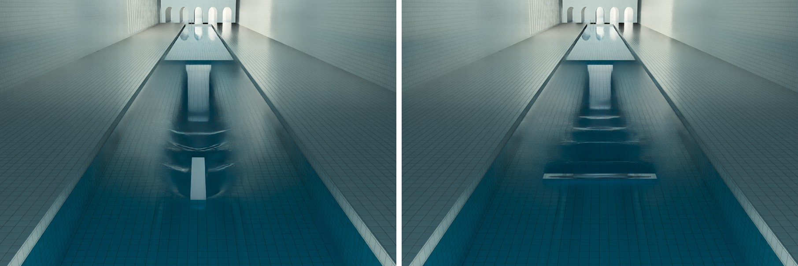
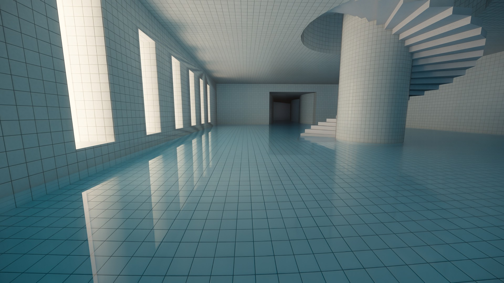
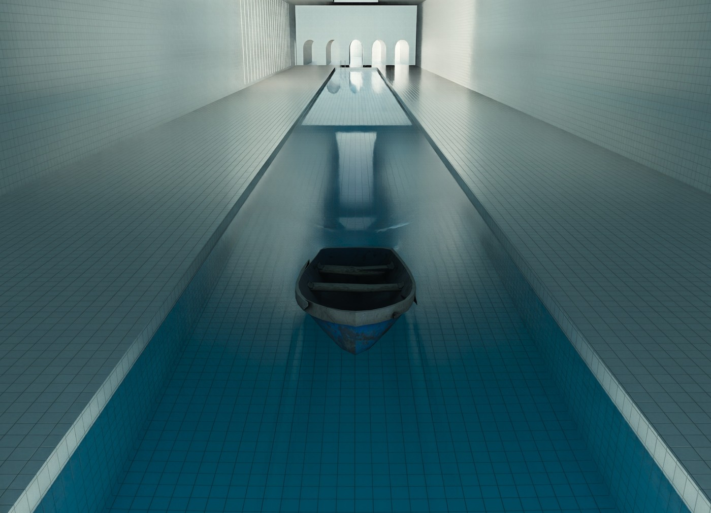

# RTX Water

Path-traced water for Garry's Mod RTX on any map. It replaces a map's water with a RTX Remix
translucent water surface of your choice. The surface reacts to the world. With the native
core, the waves are simulated with the dispersion of real water, and players, NPCs, props and
vehicles push the water with their actual shapes: a plank pushed lengthwise leaves a narrow
wake and pushed sideways a broad one, a boat leaves a Kelvin wake, a dropped crate sends out a
ring the shape of its outline, and walls reflect it all. The waves are real geometry, so Remix
refracts and reflects through the disturbed surface.



## What it does

- **Water types**: swimming pool, clear spring, lake, ocean, murky pond, muddy / sewer. Each
  is a Remix translucent material: colour after a set distance, refraction index 1.333, and a
  diffuse layer for the murky and muddy ones. `auto` picks the type closest to the map's own
  water colour (`$fogcolor`), so murky ponds stay murky and pools stay blue.
- **Waves**: calm (mirror flat, uniform), ripples (fine, fast) or waves (broad swell). The
  wave normal maps are animated by Remix's animated-water option, so strength, speed,
  direction and size change in game without rebuilding anything.
- **Interaction** (native core): a wave simulation on the water around anything in it (see
  [How RTX Water simulates waves](rtx_water/wave_simulation.md)):
  - bodies push the water as their collision hulls (props, vehicles) or animated hitboxes
    (players, NPCs, ragdolls), so the waves follow their shapes and motion: bow waves, troughs
    and Kelvin wakes behind moving bodies, rings shaped like what falls in, wading legs;
  - waves travel at deep-water speeds, longer ones faster, so splashes spread into trains of
    rings; walls reflect them, steep crests break;
  - a body floating at rest leaves the water flat around it; open hulls stay dry inside;
  - the harder something hits the water, the bigger its waves: a body going in opens a cavity
    that grows with its speed and closes into rings; one pulled out lifts the water after it;
  - bullet impacts are pressure impulses, as strong as the round. The server reports every shot
    that reaches the water (players', NPCs', and in single player your own, which the client
    never sees by itself).
- **Splashes**: what something throws up as it goes in, comes out or is shot, as real geometry
  in the water's material: a sheet that rises from the waterline and breaks up into drops,
  flying drops, a jet from the closing cavity, and drips from whatever was pulled out.
  - They follow the shape of what hits the water: the sheet rises all along its outline at the
    waterline, square round a crate, along both sides of a plank, one round each leg.
  - A flat underside slams and throws a fast, low skirt of spray; a round or pointed one throws
    a slower, steeper crown. Compact bodies hit hard close their cavity into a jet, and faster
    still, the crown closes over it.
  - They grow smoothly from nothing with the speed of the hit (the sheet's height with its
    square), with no speed at which they suddenly start; they lean with its angle (spray
    ahead of a slanted hit, a body's jet back up its path, and a bullet's plume ahead along
    the shot, straight up only from a shot straight down and lower the flatter it came in);
    the drops that fall back make rings of their own; and they vary as much as
    `rtx_water_splash_randomness` says.
- **Under water** (native core): the camera starts inside the water's material, so the surface
  seen from below refracts as real water does. Overhead is Snell's window; past the critical
  angle (48.6° from vertical at refraction index 1.333) the surface mirrors the pool, and the
  view is dimmed with the water's colour.
- **The engine's own water effects** are hidden where RTX Water replaces them: the flat ripple
  and wake quads, and the spray sprites of bullet and body splashes.
- **Interaction** (Lua meshes, without the native core): rings, a splash when something enters
  the water, a wake while it moves and ripples from bullets.
- **Map profiles**: maps (or other addons) can ask for a type and wave pattern; gm_poolrooms
  asks for a calm swimming pool, gm_construct gets a rippled lake.

| gm_poolrooms, calm pool | a rowboat hull at 70 units/s |
|---|---|
|  |  |

## Install

RTX Water ships with this repository's builds: the addon (`garrysmod/addons/rtx_water`), its Remix
mod (`rtx-remix/mods/rtx_water`) and the native core (`garrysmod/lua/bin/gmcl_rtxwater_win64.dll`,
64-bit). To run it from a checkout instead, close the game (Remix only discovers a new mod at
startup) and link the two folders:

```bat
mklink /J "<GarrysMod_RTX>\rtx-remix\mods\rtx_water" "<repository>\garrysmod\rtx-remix\mods\rtx_water"
mklink /J "<GarrysMod_RTX>\garrysmod\addons\rtx_water" "<repository>\garrysmod\garrysmod\addons\rtx_water"
```

and copy the native core into `<GarrysMod_RTX>\garrysmod\lua\bin` (`source\rtx_water\build.bat
install` builds and copies it). It is optional but recommended: without it the addon draws the
water with Lua meshes; with it the water costs the game thread next to nothing (see Performance).
The module stays loaded for the whole game session, so replacing the DLL needs a game restart.

Load any map with water. The console prints a `[RTXWater]` line with the faces found, the
type chosen and whether the native core is in use. Settings are in the spawn menu under
Utilities > RTX > RTX Water.

Requirements: GMod RTX (x64) with gmRTX's Lua Remix API (`RemixConfig`, `RemixMaterial`). The
native core also needs a Remix runtime with persistent instances and `CreateMeshBatched` (built
and tested with dxvk-remix-gmod `remix-main+c6b48ed1`); if the runtime or GMod's material system
is not one it recognises, it says why in the status line and the Lua meshes are used instead.

## Settings

| Console variable | Default | |
|---|---|---|
| `rtx_water_enable` | 1 | RTX Water on or off |
| `rtx_water_type` | auto | `auto`, `pool`, `clear`, `lake`, `ocean`, `murky`, `muddy` |
| `rtx_water_waves` | auto | `auto`, `calm`, `ripple`, `swell` |
| `rtx_water_wave_strength` | 1 | wave height multiplier (0–3) |
| `rtx_water_wave_speed` | 1 | wave speed multiplier (0–5) |
| `rtx_water_wave_direction` | 35 | direction the waves travel, degrees |
| `rtx_water_wave_scale` | 1 | wave size multiplier (0.25–4) |
| `rtx_water_interaction` | 1 | waves from players, NPCs and objects |
| `rtx_water_interaction_strength` | 1 | how hard bodies and bullets push the water (0–3) |
| `rtx_water_interaction_reach` | 1 | how far waves travel before they die out (0.25–4); it divides the simulation's damping (Lua rings: multiplies their decay) |
| `rtx_water_interaction_quality` | 2 | wave detail: 1 low, 2 medium, 3 high (mesh resolution and vertex budget; the simulation is the same) |
| `rtx_water_interaction_rate` | 30 | wave geometry updates per second (0: every frame); the simulation steps 60 times a second regardless |
| `rtx_water_bullets` | 1 | bullet impacts make waves (and splashes) |
| `rtx_water_splashes` | 1 | splashes: drops, crown sheets and jets from bodies and bullets (needs `rtx_water_interaction`) |
| `rtx_water_splash_strength` | 1 | how high and how much water splashes (0–3) |
| `rtx_water_splash_drops` | 200 | splash drops in the air at most (each is a draw call) |
| `rtx_water_splash_randomness` | 0.5 | how much splashes vary in amount, height, speed, angle and drop size (0: the same splash every time; 1: as varied as they get) |
| `rtx_water_mesh` | 1 | draw the surface with RTX Water; 0 keeps the map's own faces (no ripples) |
| `rtx_water_native` | 1 | use the native core when it is installed |
| `rtx_water_custom` | 0 | native core only: use the three settings below instead of the type's look |
| `rtx_water_color` | 0.62 0.89 0.97 | custom colour: what survives the clarity distance |
| `rtx_water_clarity` | 150 | custom clarity: that distance, in units |
| `rtx_water_ior` | 1.333 | custom refraction index |

`rtx_water_status` prints the current state and the game-thread cost, `rtx_water_reload`
rebuilds the water for the map, `rtx_water_reset` restores every default.

## For maps and addons

```lua
-- Choose the water for a map (fields are optional; players' settings still override them).
hook.Add("RTXWater_MapProfile", "MyMap", function(map)
    if map == "gm_mymap" then
        return { type = "pool", waves = "calm", wave_strength = 1, wave_speed = 1, wave_scale = 1, interaction = true }
    end
end)

hook.Add("RTXWater_Started", "MyAddon", function(state) end)              -- water is up on this map
hook.Add("RTXWater_StateChanged", "MyAddon", function(state, old) end)    -- settings changed (state nil: stopped)
RTXWater.GetState()   -- { type, waves, strength, speed, direction, scale, interaction, native, ... } or nil
RTXWater.IsCalm()     -- true when there are no waves to speak of
```

gm_poolrooms uses the profile hook for its pool and `RTXWater_StateChanged` to show its
caustics only while the water has waves.

## How it works

- **Finding the water**: the world's water faces come from `GetBrushSurfaces()`; their top
  faces are grouped by height into planes and cut into 64-unit tiles, 16 × 16 tiles to a block.
  Water on brush entities keeps the map's faces and only gets the chosen material.
- **Materials**: one Remix material per water type and wave pattern (18 in the mod), each keyed
  by its own small tag texture. Switching type or waves in game is a texture swap. The map's own
  water faces get a "hidden" tag in Remix's hidden category, and RTX Water draws the surface
  itself. The water materials are also flagged translucent, so Source draws what lies
  underneath in the main view.
- **Waves (native core)**: a height field of 4-unit cells on the 64-unit tiles that carry waves,
  stepped 60 times a second on the core's worker thread. It is Tessendorf's iWave with a
  convolution kernel fitted to deep-water dispersion, damping on the velocity only, breaking at
  the Stokes slope and mirror cells at walls. Bodies push it as pressure patches rasterised from
  their collision hulls or hitboxes, which `cl_bodies.lua` sends every frame (hull shapes once
  per model). [How RTX Water simulates waves](rtx_water/wave_simulation.md) has the model, the
  research it comes from, the checks and the limits.
- **Drawing the waves**: only tiles near the camera, roughly in view and with visible waves are
  tessellated, most important first, within a vertex budget. Nearby tiles get full detail and
  farther ones half. The flat block meshes leave those tiles out, so the surfaces never overlap.
- **Going in, coming out**: `cl_ripples.lua` checks every frame whether a body near the water
  has crossed its surface, at the speed of its lowest point (faster than 12 units/s). What
  crosses is the plan of the body's lowest 12 units, from its collision hull or hitboxes
  (`cl_bodies.lua`, `W.Bodies.Footprint`): one outline per part, overlapping parts merged.
  How flat its underside is: how much of that plan is in the water within 3 units. Going
  in, the cavity's impulses follow each outline (a row of them along a long one) and land
  when the cavity closes, about 2 sqrt(D / g) after the hit; coming out, a lift under it. For
  0.6 s after the hit, whatever more of the body goes under splashes too, at the speed the
  body has then (a ragdoll's hand goes in first, its body slaps the water after). The
  native core's push of the body's shape alone makes the same waves at any speed
  ([details](rtx_water/wave_simulation.md#hitting-the-water)).
- **Bullets**: `sv_bullets.lua` traces each pellet's own path (`PostEntityFireBullets`) for the
  first water along it and sends the points to the players who can see or hear them. Without
  RTX Water on the server, a client only has the shots it predicts itself (its own, in
  multiplayer).
- **Splashes** (`cl_splash.lua`, which also lists the research behind them): drops and jets are
  static meshes (a sphere and a column) drawn under their own transforms, so they cost no
  vertex work in Lua. A sheet bends round its outline (corners rounded), rises and leans in
  ways no transform follows, so it is built each frame while it stands: a closed shell along
  the outline with fingers along its rim, a few hundred vertices, 1,500 quads a frame at most.
  All are drawn with the type's calm material. A sheet rises at a speed that goes with the
  impact speed (up to 1.2 times it for a flat underside), thrown at 70° from the water for a
  round underside down to 46° for a flat one, leans out at most 0.6 units per unit of height,
  and stays whole up to 0.6 hydraulic diameters (4 area / perimeter) high: above that, and
  once it falls back, it is drops. The amount of water thrown goes with q² / (1 + q), q the
  impact speed over 300 units/s. Drops fly ballistically under `sv_gravity` with air drag; those that
  land on the water make impulses. A hit's direction (the bullet's, or a body's velocity as it
  crosses the surface) leans the pieces and makes the sheet taller ahead of it.
- **The engine's effects**: `effects/splashwake1`, `3` and `4` (`FX_WaterRipple`'s quad, vehicle
  wakes) get `MATERIAL_VAR_NO_DRAW` while RTX Water draws the surface, and `effects/splash2`
  (the spray of `FX_GunshotSplash`) while it makes splashes. Their flags are kept and restored
  with the water materials'.
- **Lua path** (no native core): each ripple is a ring-shaped wave packet with its own
  wavelength, speed and decay, from precomputed shape tables, drawn as GMod meshes rebuilt at
  `rtx_water_interaction_rate`.
- **Native core** (`source/rtx_water/rtxwater.cpp`): the surface goes straight to Remix through its C API.
  Calm water sits in persistent Remix instances, so nothing at all is submitted per frame. The
  wave tiles are simulated and tessellated on a worker thread into indexed meshes; the game
  thread only hands over the view and the bodies. Remix's mesh, material and destroy calls are not all safe from GMod's game
  thread while it renders on its own thread (`mat_queue_mode -2`). So meshes are made with
  `CreateMeshBatched` and shown with persistent instances, which Remix applies at Present. Mesh
  and material destruction is queued onto the render thread through the material system's call
  queue. The core checks that queue's layout against GMod's `materialsystem.dll` code before
  using it. The material is a Remix API material, which is what makes the custom colour,
  clarity and refraction settings possible.
- **Under water**: Remix traces every camera ray as starting in air unless it is told
  otherwise, and then takes the surface seen from below for a way into the water: no total
  internal reflection, no Snell's window. Once a frame the draw hook asks the engine whether
  the view origin is in a water volume (`util.PointContents`), and while it is, the native core
  makes the water material the camera's medium (`SetCameraMediumMaterial`, on the render
  thread like the other calls that emit device commands). It is sent again every frame
  because Remix forgets it whenever it clears its scene (camera cuts, mod reloads), and cleared
  when the view leaves the water or RTX Water stops.
- **Leaving a map**: the map's materials are left as they are while it unloads. A material
  changed in the `ShutDown` hook leaves queued render work that runs after the material is
  freed, and GMod crashes. Their original values are kept in `data/rtx_water/originals.json`,
  and the next start puts back any water material another map left with RTX Water's tags.

## Performance

gm_poolrooms, 4K path tracing (frames are GPU-bound, 19 to 33 ms either way):

| | Game thread per frame | Wave update | Vertices |
|---|---|---|---|
| Native core, nothing in the water | 0.017 ms | 0.03 ms (worker) | about 1,000 |
| Native core, the player standing in the water | 0.03 to 0.05 ms | 0.1 ms (worker) | about 1,000 |
| Native core, an NPC wading through it at 100 units/s | 0.07 ms (max 0.08) | 0.54 ms (worker, max 0.91; up to 97 tiles) | up to about 19,500 |
| Native core, a boat or beam crossing the canal | 0.03 to 0.04 ms | 1 to 2 ms (worker, 100 to 190 tiles of waves) | 13,000 to 21,000 |
| Lua meshes, calm | 0.235 ms | 0.35 ms (game thread) | about 1,400 |
| Lua meshes, stress (walking, shooting, dropping props) | 0.92 ms (max 1.28) | 1.70 ms (game thread, max 2.51) | about 6,000 |

On the game thread, the native core costs the bodies it sends: a rigid body is one matrix, a
player or NPC its hitbox bones. The local player in first person has no drawn model, so its
bones are set up just for this, 15 times a second (about 50 µs each), and not at all while it
stands still. The wave simulation runs on the worker thread, with an AVX2 convolution where the
CPU has it, on the tiles that carry waves only. The entity scan that finds what is near water
costs 0.02 to 0.06 ms, 20 times a second. Each wave update hands Remix one new mesh (30 a second
by default); lower `rtx_water_interaction_rate` or `rtx_water_interaction_quality` if the Remix
side is the bottleneck.

## Layout

Paths from the repository root; `garrysmod/` is what ships, laid out like the game folder.

```
garrysmod/garrysmod/addons/rtx_water/
                        lua/autorun/rtx_water.lua       loads the client files, starts on every map
                        lua/rtx_water/cl_data.lua       generated: presets, tag textures, hashes
                        lua/rtx_water/cl_core.lua       settings, map profiles, materials, lifecycle
                        lua/rtx_water/cl_surface.lua    water discovery, tiles, flat surface meshes
                        lua/rtx_water/cl_ripples.lua    what is near water, going in and out, bullets, Lua ripple meshes
                        lua/rtx_water/cl_bodies.lua     body shapes (hulls, hitboxes) and poses for the core
                        lua/rtx_water/cl_splash.lua     splashes: drops, crowns, jets, drips
                        lua/rtx_water/sv_bullets.lua    server: where shots go into the water
                        lua/rtx_water/cl_native.lua     native core glue, custom look
                        lua/rtx_water/cl_menu.lua       spawn menu panel
                        materials/rtx_water/*.vtf       tag textures (one Remix hash each)
garrysmod/rtx-remix/mods/rtx_water/
                        mod.usda, materials.usda, textures/*.rtex.dds   (generated)
source/rtx_water/       rtxwater.cpp                     the native core (gmcl_rtxwater_win64.dll)
                        wavesim.h, wavesim.cpp           the wave simulation
                        premake_project.lua, build.bat   its build: the repository's premake workspace, or standalone
                        test/                            offline wave scenarios (wavetest.exe, view.py)
                        test/ingame/                     scripted tests on gm_poolrooms' canal, redeploy.py
                        tools/presets.json               water types and wave patterns
                        tools/build_water.py             builds the Remix mod, tag textures and cl_data.lua
                        tools/fit_wave_kernel.py         fits the simulation's kernel to deep-water dispersion
                        work/, build/                    generated wave maps, previews, builds (not in git)
docs/RTX_WATER.md       this page; docs/rtx_water/ has its images and wave_simulation.md
```

## Building

- **Remix mod, tag textures and Lua data**: edit `source/rtx_water/tools/presets.json`, then
  `python source/rtx_water/tools/build_water.py` (`POOLRTX_DDS_QUALITY=production` for release
  textures). It writes into `garrysmod/` and shares the texture helpers of
  `source/gm_poolrooms_rtx/tools` (Python 3.12 with numpy, scipy, Pillow, xxhash; DDS encoding uses
  `nvtt_export.exe` from the RTX Remix app). `mod.usda` is rewritten atomically, so a running game
  hot-reloads the materials.
- **Native core**: the repository's premake workspace builds it with everything else
  (`premake5 --os=windows --gmcommon=./garrysmod_common vs2022`, then the `gmcl_rtxwater` project,
  x64 only; output `x86_64/Release/gmcl_rtxwater_win64.dll`), and CI packs it into the builds.
  `source\rtx_water\build.bat` builds the same DLL without premake (VS 2022 Build Tools, the
  repository's garrysmod_common and `public/include`; `GMOD_COMMON_INCLUDE` and `REMIX_INCLUDE`
  override them); `build.bat install` also copies it into the game, which must not be running.
- **Wave simulation, offline**: `source\rtx_water\test\build_test.bat` builds `wavetest.exe`; run
  it in `source\rtx_water\test\build` with a scenario (`kelvin 80`, `plank 60`, `float`, `drop`,
  `walk`, `bullet`, `wake 80`) and turn its dumps into images with `python ..\view.py *.raw`. After
  changing the cell size, kernel radius, spring or time step, refit the kernel with
  `python source\rtx_water\tools\fit_wave_kernel.py` and paste its table into `wavesim.cpp`.
- **Wave simulation, in game**: `source\rtx_water\test\ingame\redeploy.py` quits the game,
  installs the built DLL and reloads gm_poolrooms. `shape_test.py` moves a prop through the canal
  (for example `models/hunter/blocks/cube025x2x025.mdl 60 beam --yaw 90`), `drop_test.py` drops
  one in and `bullet_test.py` fires impulses, each taking screenshots and printing the core's
  stats. They drive the game through `source/gm_poolrooms_rtx/tools/game.py`.

## Notes and limits

- Only horizontal water is redrawn (the top faces of the world's water). Sloped water and water
  on brush entities keep the map's own faces, with the chosen material.
- The wave patterns (ripples, waves) are normal maps animated by Remix: they show in
  reflections and refraction but do not move the geometry. The waves from interaction do.
  Calm water has no normal map at all and is a flat mirror.
- The wave simulation is one-way: the water does not push bodies (Source's buoyancy floats
  them), it uses deep-water dispersion whatever the depth, and it has no capillary ripples.
  Spray is not part of it: splashes are drawn beside it and only touch it where their drops
  land. Bodies push as their collision hulls or hitboxes, so a model whose hull is much larger
  than the model pushes where the hull is. Open hulls stay dry inside when the hull is solid
  below the waterline and the draft is under 12 units. Details in
  [rtx_water/wave_simulation.md](rtx_water/wave_simulation.md).
- Without the native core, interaction falls back to Lua rings (no shapes, no simulation).
- Splashes are drawn in the water type's own look, also when the native core's custom colour,
  clarity and refraction (`rtx_water_custom`) are on. They do not collide: drops that come down
  beside the water vanish at its height.
- Explosions in water keep the engine's columns (`effects/splash1`, `splash3`) and make no RTX
  Water splash.
- A splash's outline is convex per part of the body (an L-shaped prop splashes as its convex
  hull), and parts whose outlines overlap are merged. Until a model's shape has been made (the
  scan does it within a twentieth of a second of the body coming near the water), its
  bounding box stands in.
- With `rtx_water_mesh 0` the map's faces are drawn with the chosen material and there are no
  ripples (both need the redrawn surface).
- Whether the view is under water is the engine's test against the water at rest, as for its
  own underwater fog and sounds. A camera within a wave's height of the surface can be on the
  other side of the drawn waves for a moment. Without the native core (Lua meshes, or
  `rtx_water_mesh 0`) the camera does not start in the water.
- The native core's render-queue access is checked against the material system's machine code.
  A GMod update that changes that code turns the native core off, with a status message, until
  the core is updated.
