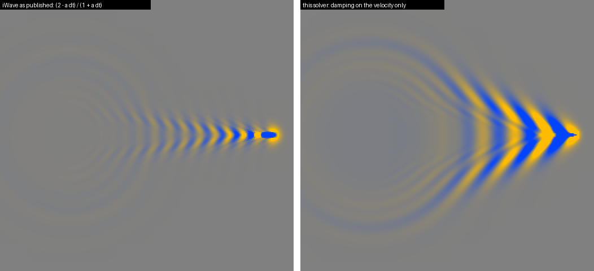
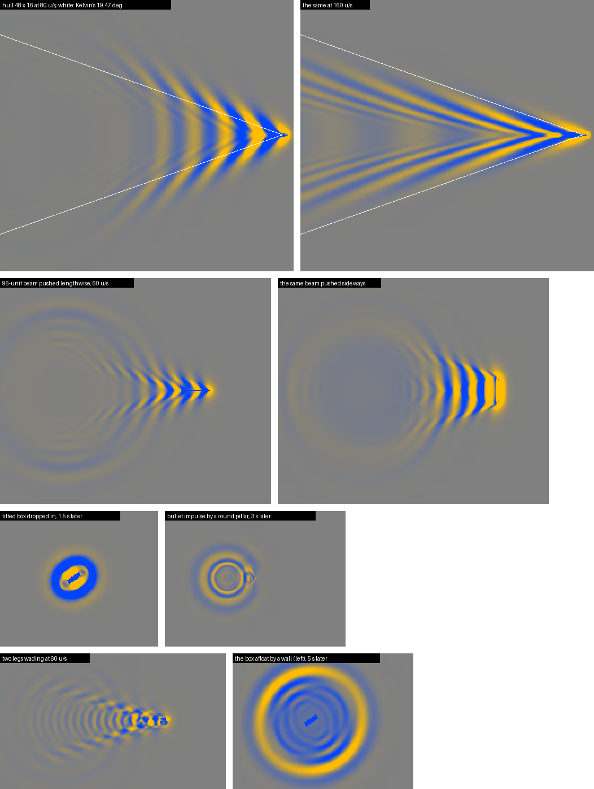
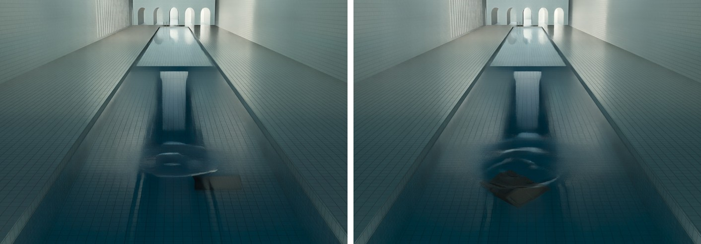

# How RTX Water simulates waves

With the native core installed, the water surface around players, NPCs, props, vehicles and
bullet impacts is a simulated height field instead of canned rings: waves travel at the speeds
of real water, bodies push the water with their actual shapes, moving bodies leave Kelvin wakes,
and walls reflect. This page explains the model, the sources it comes from, how it was checked,
and where it is still an approximation. The code is `source/rtx_water/wavesim.h` and `wavesim.cpp`;
`garrysmod/garrysmod/addons/rtx_water/lua/rtx_water/cl_bodies.lua` feeds it the bodies (paths
from the repository root).

## What real-time water simulations do

The research behind this, with what each approach would mean here:

- **Height fields with the wave equation** (Müller-Fischer, GDC 2008, *Fast Water Simulation for
  Games Using Height Fields*; many game engines). Each column of water is a height. A 5-point
  Laplacian gives h_tt = c² ∇²h: every wavelength travels at the same speed. That is how shallow
  water behaves, but in a pool a few feet deep, ripples a few inches to a few feet long are
  deep-water waves, and those disperse. Without dispersion a splash stays a single sharp ring and
  a moving body leaves a Mach cone instead of a Kelvin wake.
- **iWave** (Jerry Tessendorf, *Interactive Water Surfaces*, Game Programming Gems 4). The same
  height field, but the Laplacian is replaced by the vertical derivative operator √(−∇²), as a
  convolution kernel. That gives deep-water dispersion, ω² = g|k|: long waves outrun short ones,
  splashes spread into trains of rings, and wakes come out right on their own. Sources add height
  (h += s), obstructions zero it (h ·= o), and a moving obstruction that is also a source
  (s = 1 − o) leaves a wake. This is the base of RTX Water.
- **Volume displacement** (Thürey, Müller-Fischer, Schirm and Gross, *Two-way rigid body
  coupling in shallow water simulations*, NVIDIA, US patent 8,041,550). A body's submerged
  volume per column changes as it moves, and the change is pushed to the neighbouring columns
  (α Δb / 4), while the water's forces move the body. That conserves water but couples only to
  the nearest cells, on a shallow-water (non-dispersive) surface.
- **Wave particles** (Yuksel, House and Keyser, SIGGRAPH 2007) and **water wave packets /
  surface wavelets** (Jeschke and Wojtan, 2017 and 2018). Waves carried by particles or packets,
  with exact dispersion and very large areas. Bodies are turned into wave sources by sampling
  their silhouettes. They need their own renderer and source models, and they don't fit
  tile-by-tile meshes for Remix.
- **Crest** (Unity ocean). Dynamic waves are a wave-equation height field in cascaded LODs,
  with spheres as interaction shapes and a damping term.
- **Ship-wave theory** (Havelock; Kelvin's wake). A moving body is a pressure distribution on
  the surface. Its steady linear response is the Kelvin pattern, confined to a wedge of half-angle
  arcsin(1/3) = 19.47° because a deep-water wave's energy travels at half its phase speed. At high
  Froude numbers the visible wake narrows (Rabaud and Moisy, 2013).

RTX Water keeps iWave's height field and convolution, fixes its numerical problems, and drives
it with the pressure-patch view of a body from ship-wave theory, rasterised from each body's
real shape.

## The model

The surface is a height h on a grid of 4-unit cells, 16 to a 64-unit tile, stepped 60 times a
second:

    d²h/dt² + α dh/dt = −(g K + β)(h + head)

- **K** is a radial convolution of 137 taps (radius 6 cells) standing in for √(−∇²). Tessendorf
  builds it from a smoothed Bessel integral and normalises its centre. In physical units that
  kernel makes short waves move at half their real speed and long ones up to 90 % too fast. Here
  `source/rtx_water/tools/fit_wave_kernel.py` fits the taps instead, by least squares over the
  whole 2D frequency zone. The taps sum to zero, so no water is created, and the response never
  goes negative, so the explicit step is stable.
- **β**, a spring of 10/s². A kernel 24 units wide cannot follow |k| down to the longest waves;
  its response there grows like k², so long waves would all travel at about 70 units/s whatever
  their length. Kernel and spring are fitted together so that g K + β ≈ g|k|.

  As the solver steps it, the phase speed is within 1.2 % of deep water from 12 to 64 units of
  wavelength and within 4 % from 96 to 192 (`fit_wave_kernel.py` prints the table). The spring
  acts on the free surface h + head, not on h. So a floating body settles exactly into its dip,
  and the water it displaces goes as if into the whole pool rather than spreading over every tile
  as a swell.
- **Damping α = 0.35/s acts on the velocity only.** Tessendorf's paper steps the equation as
  h' = h (2 − α dt)/(1 + α dt) − h_prev/(1 + α dt) − …. For a constant height the first two terms
  do not cancel, so the scheme also pulls the height itself back to rest. That is a spring of
  2α/dt, about 42/s² at 60 steps a second. It makes every wave from 12 to 128 units long travel
  10 to 70 % too fast, keeps floating bodies from settling (a crate sat 4 units deep instead of
  12, with a 1.8-unit bulge around it), and wrecks the Kelvin wake. The consistent form is
  (2 + α dt).

  
- **Viscosity**: the surface velocity's Laplacian, so damping grows with k² and grid-scale noise
  dies within a few steps while long waves travel on.
- **Breaking**: where the free surface is steeper than 0.45 (the Stokes limit, wave height about
  a seventh of the wavelength), its vertical motion is damped, the way white-capping takes energy
  out of a crest. The slope uses a 3 × 3 Sobel stencil and the damping is blurred over 3 × 3. A
  per-cell switch measured with central differences, which can't see two-cell waves, lined every
  wake with grid-scale stitches.
- **Walls** reflect as a vertical wall does: no flow through it, the surface free to rise and fall
  against it. Every land cell the kernel reads takes the height of its mirror image across the
  wall (a ghost cell), so a wave hits a wall crest-first and comes back without changing sign. iWave
  zeroes the height at obstacles instead, which pins the water at every wall and reflects waves
  upside down.

### Bodies

Each entity near the water is sent every frame with its shape. Props, vehicles and other physics
objects use their collision hull (`GetMeshConvexes`). Players, NPCs and ragdolls use their
hitboxes, following the animated bones, so wading legs and swimming arms push the water where they
are. Anything else uses its bounding box.

The core rasterises each convex part into the grid at 2 × 2 samples a cell and finds the depth the
body reaches below the surface in every column:

- **Where the body pierces the surface**, that depth (capped at 12 units) is the column's *head*, a
  pressure ρ g head on the surface. This is the pressure-patch model of linear ship-wave theory.
  At rest the water settles into the body's dip and lies flat around it. Moving, the same patch
  raises the bow wave, digs the trough behind and sheds the Kelvin wake. A body's footprint is its
  real waterplane, so a plank pushed lengthwise makes a narrow wake and pushed sideways a broad
  one, a tilted box drops in with an oval ring, and a boat's hull leaves a boat's wake.
- **Parts wholly under water** push only with what changed in the last half second (a high-pass),
  and less the deeper they are (exp(−depth/16)). Something resting on the bottom leaves the
  surface alone; something moving just under it does not.
- **What is drawn**: the simulation uses the push blurred over one cell, which keeps grid noise
  down. The drawn surface pulls the dip back one cell inside the waterline (an eroded footprint).
  It stays hidden in the body, open hulls stay dry inside, and floating bodies show no moat.
- **Bodies that leave**: a column the body moves out of loses its push at once and the water rushes
  in. A body that disappears (removed, out of reach) lets go over 0.3 s instead of leaving a hole.
- **Bullets** are a pressure impulse for one step. The kernel turns it into a push down in the
  middle and up around it with no net flow, so the crater refills from its rim into a train of
  rings.

Body samples are interpolated: the simulation runs one step behind the newest sample.

### Where it runs

Only 64-unit tiles that carry waves are simulated. A tile wakes its neighbour when waves near the
shared edge pass 0.008 units, and stops after a second and a half below 0.01 units (half the
smallest wave that is drawn). The step runs on the native core's worker thread, with an AVX2/FMA
convolution when the CPU has it. The game thread only sends the bodies.

## How it was checked

`source/rtx_water/test/wavetest.cpp` (built into `test/build/wavetest.exe`) runs scenarios on a
synthetic pool and dumps the drawn height field (`test/view.py` turns the dumps into images: orange up, blue down):

- **Dispersion**: the fitted, stepped scheme against ω² = g k, printed by `fit_wave_kernel.py`.
- **Kelvin wake** (`kelvin 80`, `kelvin 160`): a 48 × 16 hull lowered in gently and brought up to
  speed. At 80 u/s the pattern is Kelvin's, curved transverse crests meeting divergent ones, inside
  the 19.47° wedge with the cusps along it. At 160 u/s (Froude number 1.2 on the hull's length) the
  wake is narrower, as measured on real ships.
- **Shape** (`plank`): the same 96-unit beam lengthwise and sideways.
- **Floating at rest** (`float`): a crate half in for 6 s. Its dip is 12 units inside its outline,
  and the water beside it is within 0.05 units of flat.
- **Walls** (`drop`, `bullet`): rings off a straight wall (no slope across it) and around a round
  pillar (reflection, shadow, waves bending into it).

In game, on gm_poolrooms' long canal, a beam lengthwise and sideways, a rowboat hull at 70 u/s,
drums and crates dropped in and bullet impacts:

| A rowboat at 70 u/s | A drum and a crate dropped in |
|---|---|
|  |  |

Cost there (4K path tracing, about 30 fps): the game thread spends 0.03 to 0.05 ms a frame on the
water with a body moving or the player standing in it, and 0.07 ms with an NPC wading through it.
The worker spends 0.1 ms per update idle, 0.5 ms with the wading NPC, and 1 to 2 ms with a boat or
beam leaving 100 to 190 tiles of waves (two or three steps per update).

## Limits

- **One-way coupling**: the water does not push back. Source's own buoyancy floats the props, and
  the waves don't rock them.
- **Deep-water dispersion everywhere.** In shallow water (a pool's shallow end) real long waves are
  slower, √(g × depth) at most. The simulation does not know the depth.
- **Waves longer than about 250 units** travel too fast (13 % at 256, more beyond). Their
  frequency cannot drop below √β, so they barely carry energy away. That mostly matters for very
  fast bodies, whose transverse waves are that long.
- **Capillary waves** (under an inch, below the grid) and **spray, splash sheets and jets** (not a
  height field) are not simulated. A bullet makes rings, not a plume.
- **Hollow hulls**: an open boat stays dry inside if its collision hull is solid below the
  waterline (HL2's boats are) and its draft is under 12 units. A boat welded together from plates
  is several bodies, and its inside floods.
- **Collision hulls** are what pushes the water, so a model whose hull is much larger than the
  model pushes where the hull is. Hitboxes are boxes, so legs push as boxes.
- Footprints wider than 512 units are skipped. Walls thinner than the kernel (24 units) let a
  little of a wave through.

## Sources

- Jerry Tessendorf, *Interactive Water Surfaces*, Game Programming Gems 4 (2004):
  https://jtessen.people.clemson.edu/reports/papers_files/Interactive_Water_Surfaces.pdf
- Matthias Müller-Fischer, *Fast Water Simulation for Games Using Height Fields*, GDC 2008 (listed
  by https://github.com/hpatjens/RealtimeWater)
- Nils Thürey, Matthias Müller-Fischer, Simon Schirm, Markus Gross (NVIDIA), *Two-way rigid
  body coupling in shallow water simulations*, US 8,041,550 B1 (2011):
  https://patents.google.com/patent/US8041550
- Cem Yuksel, Donald House, John Keyser, *Wave Particles*, SIGGRAPH 2007:
  https://cemyuksel.com/research/waveparticles/
- Stefan Jeschke, Chris Wojtan, *Water Surface Wavelets*, SIGGRAPH 2018:
  https://research-explorer.ista.ac.at/record/134 (and *Water Wave Packets*, SIGGRAPH 2017)
- Crest ocean system, dynamic waves: https://crest.readthedocs.io/en/4.15/user/ocean-simulation.html
- Kelvin wake pattern: https://en.wikipedia.org/wiki/Kelvin_wake_pattern
- Marc Rabaud, Frédéric Moisy, *Ship wakes: Kelvin or Mach angle?*, Phys. Rev. Lett. 110 (2013):
  https://arxiv.org/pdf/1304.2653
